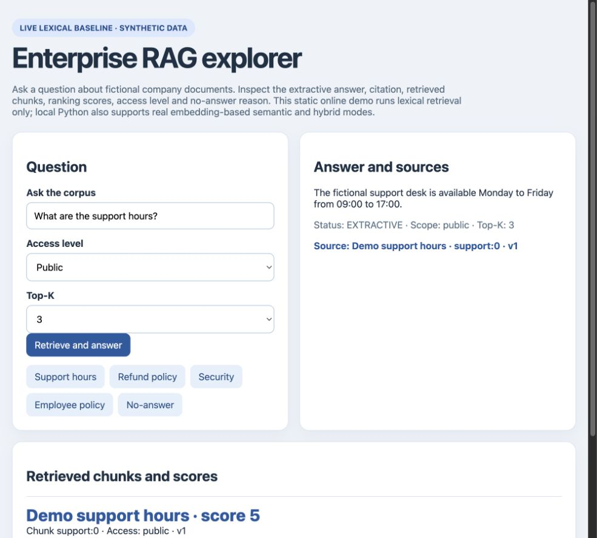
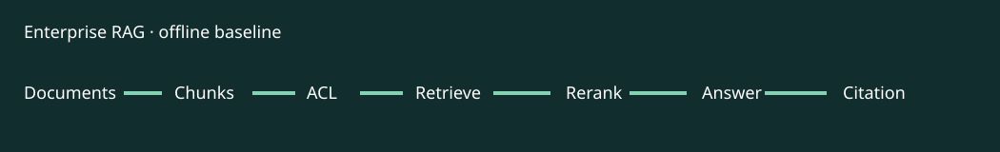

# Enterprise RAG Starter

**LIVE_DEMO (lexical) + LOCAL semantic/hybrid + LOCAL file/identity library** · [Try the browser demo](https://zhouey314-cloud.github.io/enterprise-rag-starter/) · [Case study](docs/case-study.md) · [Resume bullets](docs/resume-bullets.md) · [Interview notes](docs/interview-notes.md)

An inspectable RAG demo using entirely fictional enterprise documents. The online page is a lexical baseline; optional local Python modes use a real sentence-embedding model for semantic and hybrid retrieval. The lexical path selects a supported source sentence with citation or refuses. The optional semantic/hybrid path retains its separate, uncalibrated extraction behavior; embedding relevance alone does not establish answer support.



The image is a capture of the public lexical demo, not a generative model answer or production quality result.



## Demo

Online lexical demo: <https://zhouey314-cloud.github.io/enterprise-rag-starter/>. Try support hours, refund policy, security, employee policy (public no-answer; team-scope fictional document visible), and no-answer. The page shows answer, source, retrieved chunks, scores, access and no-answer reason. Scope selection is illustrative, not real authentication.

Python 3.10+: `python3 rag.py "What are the support hours?"`; `python3 rag.py "lunar engine warranty"`; `python3 evals/run.py`. For the full Python suite, first install `requirements-local.txt` in an isolated environment, then run `python3 -m unittest discover -s tests`; the file-format tests need the pinned PDF parser, with no model download.

Local semantic/hybrid setup:

```bash
python3 -m venv .venv
.venv/bin/python -m pip install -r requirements-semantic.txt
HF_HOME="$PWD/.model-cache" .venv/bin/python rag.py "When can I reach customer service?" --mode semantic
HF_HOME="$PWD/.model-cache" .venv/bin/python rag.py "What is the refund policy?" --mode hybrid --top-k 2
HF_HOME="$PWD/.model-cache" .venv/bin/python evals/modes.py
```

The first semantic run downloads `sentence-transformers/all-MiniLM-L6-v2` from Hugging Face into the ignored local cache. No API key is needed. Without installed dependencies or model access, semantic/hybrid raise an error; they never silently become lexical.

## Problem and architecture

Documents → parse → overlap chunk → metadata/access → lexical or local embedding cosine search → optional hybrid reciprocal-rank fusion → top-K selection → extractive answer + citation. The embedding adapter is replaceable; `LLMProvider` remains `NOT_CONFIGURED`, and no generative model runs. Access filtering happens before scoring in every mode. See [architecture](docs/architecture.md).

## Eval and verification

The current offline suite passes 49 Python tests (including real CLI/HTTP process tests) and 36 Node tests. The original four lexical retrieval fixtures and nine answerability fixtures remain unchanged. Twenty-six shared [excerpt regressions](evals/excerpts.jsonl) cover first/second/later sentences, misleading titles, missing typed values, no-answer, ACL and citation versions. The first ten improved from 2/10 to 10/10. Independent review then found that an archived phone directory or a statement that the phone number changes still lacks the requested value. The expanded set improved from 11/17 on that intermediate implementation to 17/17 after additional sentence-content and typed-value checks; subsequent hours-reference and timestamp regressions brought the final set from 18/21 to 21/21. Final cross-language checks added five Unicode boundaries; Python improved from 23/26 and JavaScript from 24/26 to 26/26 in both. All are `synthetic_unverified` regression aids, not independently verified semantic quality.

Run `python3 evals/run.py`, `python3 evals/answerability.py`, `python3 evals/excerpts.py` and `node --test tests/web.test.mjs`. Lexical extraction ranks actual sentences, retains the provisional 0.6 coverage floor, and additionally requires every question content term in the returned sentence. Only the grammatical “many” in “how many” is excluded from that completeness condition; the original coverage calculation is unchanged. Phone queries require a 7–15-digit phone-shaped value (after masking ISO dates and clock times), email queries require an address, number queries require numeric evidence, and hours queries require an explicit clock range. Natural-language schedules outside the supported clock-range format conservatively refuse. A mere reference to a phone/email attribute is insufficient. Titles help retrieval only. Explicit clock ranges supply the sentence-local “hours” cue. Numeric value syntax uses ASCII digits in both languages, while token boundaries reject adjacent Unicode letters/numbers/underscores. Fullwidth digits conservatively refuse. These are conservative lexical/value checks, not entailment, intent classification or complete validation of international contact formats.

Optional semantic/hybrid retrieval has its own `evals/modes.py` gates and requires the dependency/model; it was not rerun for this lexical repair. Generative-model quality is `NOT_RUN`. See [eval specification](evals/PROJECT_EVAL_SPEC.md) and [baseline comparison](FAILURE_ANALYSIS.md).


## Local file/identity library (separate from the static demo)

`localrag.KnowledgeStore` adds transactional MD/PDF/DOCX ingestion, source-byte and metadata hashes, monotonically increasing revisions, effective/expiry dates (expiry is exclusive), deletion, server-stored tenant/role identities and authorized FTS5/overlap RRF extraction. Install `requirements-local.txt`; run the existing unittest command. PDF pages are parser page numbers; DOCX uses paragraph locators with `page=null`, because physical layout has not been rendered. A newly imported future revision suppresses the previous revision and conservatively refuses until effective; it does not silently resurrect old policy. Conflicting eligible sources in the same administrator-assigned topic refuse even for top-K=1.

The trusted local operator must attest rights for each input. Tokens are opaque and stored only as digests in the database; callers cannot choose tenant/role through the query API. This library is not production IAM. The public static page still has illustrative scope selection. See [the local architecture decision](docs/adr-local-rag.md).

`python local_service.py --help` exposes the trusted operator CLI. Use `init`, `issue-identity`, `ingest --metadata ... --rights-attested`, `delete` and `revoke-identity` locally. Identity files are created exclusively with mode `0600`; the token is never printed. `query --token-file ...` and `source DOC_ID VERSION --token-file ...` use that identity. `serve --port 8767` binds only `127.0.0.1`; clients send `Authorization: Bearer <token>` to `POST /query` with only `question` and optional `top_k`, or to `GET /sources/DOC_ID/VERSION`. Client-supplied tenant, role, scope, identity and historical dates are rejected. Source lookup repeats current-version/date/ACL checks. This service does not expose ingestion over HTTP or enable cross-origin browser access.

The Python suite includes real child-process CLI/HTTP checks for all three formats, token revocation, denied tenant/role access, updates/deletion, expiry/conflicts and malformed requests. Those tests discovered that a shared PDF title could make the wrong page appear answerable. Extraction now requires question-term coverage in the page body; titles still help retrieval. This remains a conservative lexical heuristic, not a semantic correctness check.

Follow [the complete fresh-environment quickstart](docs/local-quickstart.md) to generate fictional MIT-licensed MD/PDF/DOCX files, provision private identities, import/update/delete, start the HTTP service, query and inspect sources, and reproduce denial and revocation. No model or embedding is called. Run `python evals/local.py` for 62 `synthetic_unverified` candidate cases (56 distinct questions), with separate retrieval, citation, literal-answer agreement, refusal and observed p50/p95 metrics. The required lexical contract covers 60 cases; two semantic-paraphrase probes remain visible failures in the full metrics. The user subsequently reported completing review of all 62 cases; see the [current user-review receipt](docs/reviews/user-review-receipt-20261021.json), bound to the reviewed candidate and queue hashes. Individual case decisions were not separately supplied. The queue and CI `pending62`/human-gate fields retain the earlier snapshot; they do not mean the user is currently waiting to review. Source/ground-truth provenance remains `synthetic_unverified`; semantic quality is `NOT_TESTED` and overall/production acceptance stays `BLOCKED`. See [the candidate eval contract](evals/LOCAL_EVAL_SPEC.md) and [human-review queue](evals/local-human-review.jsonl).

## Status, privacy and maintenance

`IMPLEMENTED_AND_TESTED`: offline lexical retrieval, local optional semantic/hybrid retrieval, citation, access filter, deterministic synthetic fixtures and the separate local file/identity library. `DEPLOYED_STATIC_APP`: online lexical-only interface. `NOT_CONFIGURED`: generative LLM and external vector store. `NOT_IMPLEMENTED`: production authentication and provider-backed groundedness eval. All supplied text is synthetic. Before production, add verified policy data, independently reviewed deployment/IAM, expert-reviewed Golden Set and trace evaluation. MIT.

This source currently has no declared package version. GitHub has a historical `v1.0.0` public demo Release; it is not evidence that this engineering reference is production-ready. This repair is delivered as source commits and the static Pages deployment, with the existing clone-and-run installation path; it creates no new package or Release. Future source-only fix releases use the next unused patch above historical `v1.0.0` (currently `v1.0.1`), bind the tag to the tested commit, and state that the number is a source snapshot, not a package or production-readiness claim. A future installable package needs its own declared package-version/install contract before release. See the [capability roadmap](ROADMAP.md), [reproduced failure analysis](FAILURE_ANALYSIS.md), [changelog](CHANGELOG.md), [contribution guide](CONTRIBUTING.md), and [release checklist](docs/releases/RELEASE_CHECKLIST.md).
